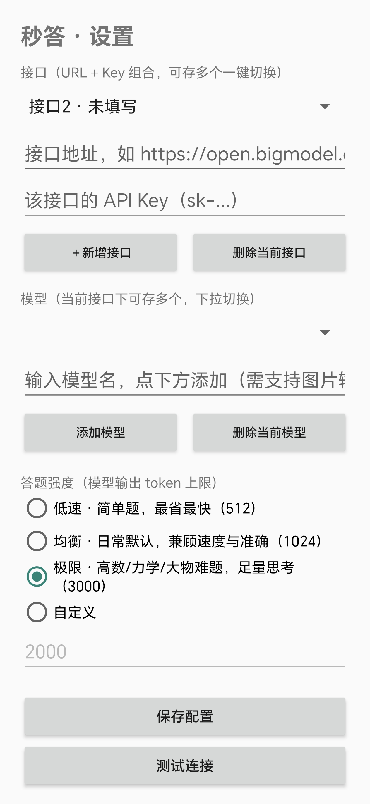
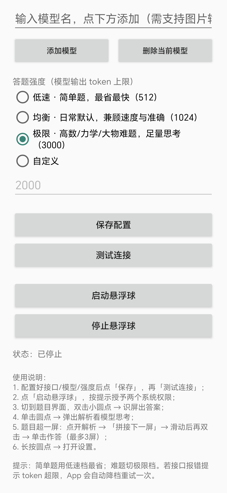
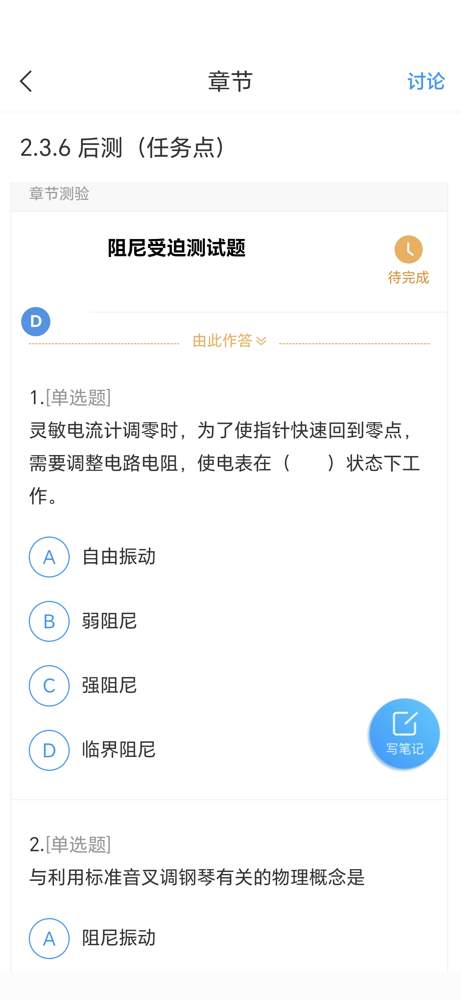
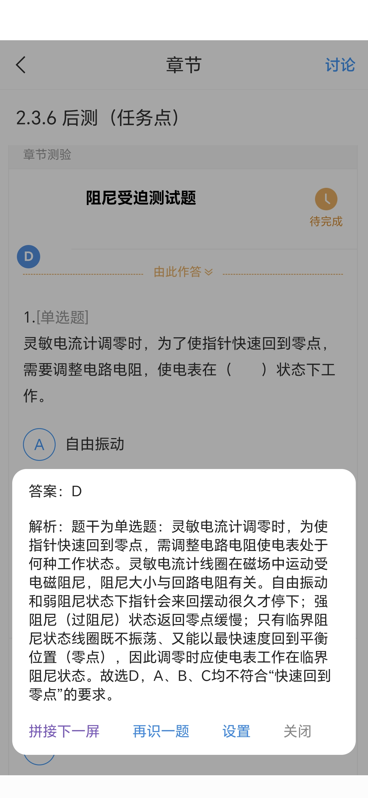

<div align="center">

# 秒答 Miaoda

**悬浮球 + 截屏识题 + AI 秒出答案的 Android 自学答题助手**

双击悬浮球，自动截取当前屏幕，AI 直接给出单选 / 多选 / 判断的答案；
不啰嗦过程，点一下答案才展开解析——把工具做成一粒不碍事的小圆点。

[](LICENSE)


</div>

---

## ✨ 功能特性

### 🎯 悬浮答题
- 常驻一枚 **24dp 半透明小圆点**，可拖动、不挡内容、误触率低
- **双击**圆点：截取当前屏幕 → 视觉模型作答 → 圆点直接变成答案（`A` / `ABD` / `对` / `错`）
- **单击**圆点：展开解析浮层，查看模型完整的推理过程
- 只处理**单选 / 多选 / 判断**三类客观题；识别不了如实显示橙色 `?`，绝不瞎猜
- `?` 同样可以点开——模型会说明自己没把握的原因

### 🧩 多屏拼接
题目超出一屏？识屏后在解析浮层点「**拼接下一屏**」，滑动到下半屏继续双击续截（最多 3 屏），一次请求整体作答，长题干、跨屏选项都能完整识别。

### 🔌 多接口档案
- **URL + API Key 组合**可保存任意多个，顶部下拉一键切换
- 每个接口下可保存**多个模型**，独立下拉切换，配置一次永久生效

### 🎚️ 答题强度四档
| 档位 | 输出上限 | 适用场景 |
|---|---|---|
| 低速 | 512 | 简单题，最省最快 |
| 均衡（默认） | 1024 | 日常题目，兼顾速度与准确 |
| 极限 | 3000 | 高数 / 力学 / 大物等需要长推理的难题 |
| 自定义 | 64 ~ 32000 | 完全自主 |

接口拒绝过大的 `max_tokens`（部分模型上限 1024）时，App 会**自动降档重试一次**，不中断使用。

### 🛡️ 答案解析
- 判断题自动适配「A 对 / B 错」式选项，统一输出「对 / 错」
- 选项被屏幕截断时基于可见部分推断，并在解析中如实标注
- 黑屏（防截屏保护的界面）自动识别，返回「屏幕受保护」而非乱答

## 📱 交互一览

**手势**

| 手势 | 效果 |
|---|---|
| 双击圆点 | 识屏出答案（第一题也是双击） |
| 单击圆点 | 展开 / 查看解析 |
| 长按圆点 | 打开设置（下拉点通知同样可达） |
| 拖动圆点 | 调整位置 |

**圆点状态色**

| 颜色 | 含义 |
|---|---|
| 半透明灰 | 待机，等待双击 |
| 蓝色 | 有答案，单击看解析 |
| 橙色 `?` | 模型没把握，点开看原因 |
| 紫色 `…` | 拼接模式，继续双击续屏 / 单击作答 |
| 红色 `!` | 出错，toast 会说明原因 |

## 📸 截图

<p align="center">
  
  
  
  
</p>

<p align="center">设置页（多接口 / 强度档位） · 悬浮球识题 · 解析浮层</p>

## 📥 安装

**方式一：下载 APK**

到 [Releases](../../releases) 下载最新的 `miaoda.apk`，传到手机直接安装（需允许「安装未知来源应用」）。

**方式二：自行编译**

```bash
git clone https://github.com/<你的用户名>/miaoda.git
cd miaoda
# 需要JDK 17+、Android SDK（API 35）、Gradle 8.9，SDK 路径写在 local.properties
gradle assembleDebug --no-daemon
# 产物：app/build/outputs/apk/debug/app-debug.apk
```

## ⚙️ 配置

App 内三步即可用：

1. 填入 **OpenAI 兼容接口地址**（如 `https://open.bigmodel.cn/api/paas/v4`）和 **API Key**——智谱、通义千问、Kimi 及各类中转均可；
2. 添加一个**支持图片输入的模型名**（如 `glm-4v-flash`），纯文本模型（如 DeepSeek）无法识屏；
3. 点「测试连接」确认可用，然后「启动悬浮球」，按提示授予**悬浮窗**和**屏幕录制**两个权限。

> 💡 模型能力决定答题质量的上限。同一道题换更强的视觉模型，正确率提升立竿见影。

## ❓ 常见问题

<details>
<summary><b>经常出橙色 ? 怎么办？</b></summary>
<br>

依次排查：① 题目和选项是否完整出现在屏幕里（最后一个选项被截断时模型只能靠猜）；② 模型本身是否够强，换更先进的视觉模型试试；③ 难题切「极限」档给足思考空间；④ 确认题目属于单选/多选/判断，主观题一律返回 `?`。
</details>

<details>
<summary><b>报 HTTP 400？</b></summary>
<br>

大概率是该模型不接受当前档位的 <code>max_tokens</code>，App 会自动降到 1024 重试一次；若仍失败，把强度调低一档或换模型。
</details>

<details>
<summary><b>拼接后答案明显只看了一屏？</b></summary>
<br>

个别中转服务只把多图请求的第一张传给模型。直接连官方接口（智谱 / 通义 / Kimi）可避免。
</details>

<details>
<summary><b>识屏结果总是黑屏？</b></summary>
<br>

目标界面开启了防截屏保护（FLAG_SECURE），系统强制截成黑屏，属于系统级行为，App 会如实提示。
</details>

<details>
<summary><b>为什么每次打开 App 都要重新授权录屏？状态栏还有录制图标？</b></summary>
<br>

Android 14 起投屏授权令牌一次性生效、录屏指示由系统强制显示，均为系统行为，本应用不做任何规避。
</details>

## ⚠️ 使用须知

- 本项目定位为**自学辅助工具**：课后刷题、作业自查、错题复盘；
- 请遵守你所在学校、课程与任课教师的规定，**不要在考核、测验等场景中使用**，由此产生的后果由使用者自行承担；

## 🏗️ 项目结构

```
miaoda/
├── app/src/main/java/com/study/quickdot/
│   ├── MainActivity.kt     设置页：多接口档案 / 模型管理 / 答题强度
│   ├── OverlayService.kt   悬浮球：手势识别 / 截屏 / 多屏拼接 / 解析浮层
│   ├── ApiClient.kt        OpenAI 兼容请求、提示词与答案解析
│   └── ConfigStore.kt      多接口配置的持久化（JSON）
├── app/src/main/res/       界面与图标资源
├── tools/pc_test.py        PC 端批量测准确率脚本（同一套提示词）
└── README.md
```

## 🛠️ 技术栈

- **Kotlin**，无 Compose，传统 View 体系，依赖只有 AppCompat / Material / OkHttp 三件
- `WindowManager` + `TYPE_APPLICATION_OVERLAY` 实现悬浮球与解析浮层
- `MediaProjection` + `ImageReader` 实现按需单帧截屏
- 自研手势分发：单击 / 双击 / 长按 / 拖动 在同一视图上共存
- 首选项 JSON 序列化实现多接口档案管理

## 🤝 贡献

欢迎 Issue 与 PR。提交前请先跑一次 `gradle assembleDebug` 确认可编译。

## 📄 许可证

[MIT](LICENSE) © 2026 Lucy Merrill
